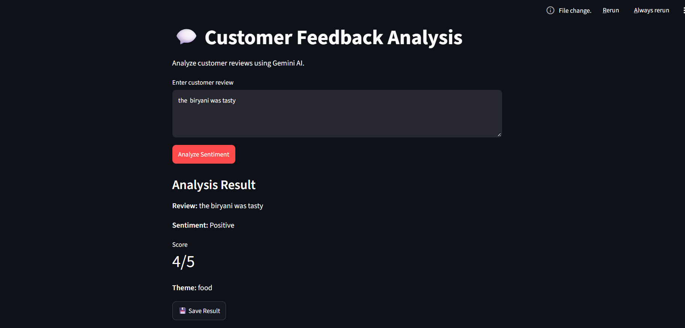

# Customer Feedback Analysis

A Gemini-powered application that analyzes customer reviews, identifies sentiment, assigns a score, extracts the main review theme, and stores analysis results for future reference.

The application uses FastAPI for backend development, Streamlit for the user interface, and SQLite for persistent storage.

## FeedX Preview




## Features

- Sentiment analysis to classify reviews as positive, negative, or neutral
- Sentiment scoring on a scale of 1 to 5
- Theme extraction to identify the main topic of a review
- REST API for processing customer reviews
- Interactive interface to submit reviews and view results
- Persistent storage of analysis results using SQLite
- Retrieval of previously saved feedback records

## Technology Stack

- Python
- Google Gemini API
- FastAPI
- Pydantic
- Streamlit
- SQLite
- Requests
- uv

## Project Structure

```text
customer-feedback-analysis/
    api.py
    streamlit_app.py
    database.py
    feedback.db
    .env
    .gitignore
    pyproject.toml
    uv.lock
    README.md
```

## Application Architecture

The application follows this workflow.

1. The user enters a customer review in the Streamlit interface.
2. Streamlit sends the review to the FastAPI backend.
3. FastAPI validates the input using Pydantic.
4. The backend sends the review to the Gemini API.
5. Gemini returns the sentiment label, score, and theme.
6. FastAPI returns the analysis to Streamlit.
7. The user can save the result to the SQLite database.
8. Previously saved records can be retrieved and displayed.

## Installation and Setup

### Prerequisites

- Python 3.11 or later
- uv package manager
- Google Gemini API key

### Clone the Repository

```bash
git clone <your-repository-url>
cd customer-feedback-analysis
```

Replace the repository URL with your GitHub repository URL.

### Install Dependencies

Run the following command in the project directory.

```bash
uv sync
```

Ensure that the project dependencies include FastAPI, google-genai, python-dotenv, Pydantic, Streamlit, Requests, and Pandas.

### Configure Environment Variables

Create a file named `.env` in the project root.

```env
GEMINI_API_KEY=your_gemini_api_key
```

Replace the placeholder with your actual API key.

Do not commit the `.env` file or expose your API key publicly.

### Start the Backend

Run the following command.

```bash
uv run fastapi dev api.py
```

The backend runs at the following local address.

```text
http://127.0.0.1:8000
```

Interactive API documentation is available at:

```text
http://127.0.0.1:8000/docs
```

### Start the Frontend

Open a second terminal in the project directory and run:

```bash
uv run streamlit run streamlit_app.py
```

Open the local URL displayed in the terminal, usually:

```text
http://localhost:8501
```

Keep both servers running while using the application.

## API Documentation

### Analyze Customer Feedback

Method: POST

Endpoint: `/analyze`

Request body:

```json
{
  "text": "The product is excellent and delivery was fast!"
}
```

Example response:

```json
{
  "label": "positive",
  "score": 5,
  "theme": "Product Quality"
}
```

The response is illustrative. Actual results depend on the review and the model output.

### Response Fields

- `label` represents the predicted sentiment.
- `score` represents the sentiment rating from 1 to 5.
- `theme` represents the main topic identified in the review.

## Database Design

The application uses SQLite to store analysis results.

The feedback table contains the following fields.

- `id` is the primary key.
- `review` stores the original customer review.
- `label` stores the predicted sentiment.
- `score` stores the sentiment score.
- `theme` stores the identified review theme.

The database module supports table creation, saving analysis results, and retrieving saved records.

## Error Handling

The application handles common errors, including empty review submissions, backend connection failures, HTTP request errors, and database operation failures.


## License

This project is intended for educational and portfolio purposes. Add an appropriate license if you plan to distribute or reuse the project.
